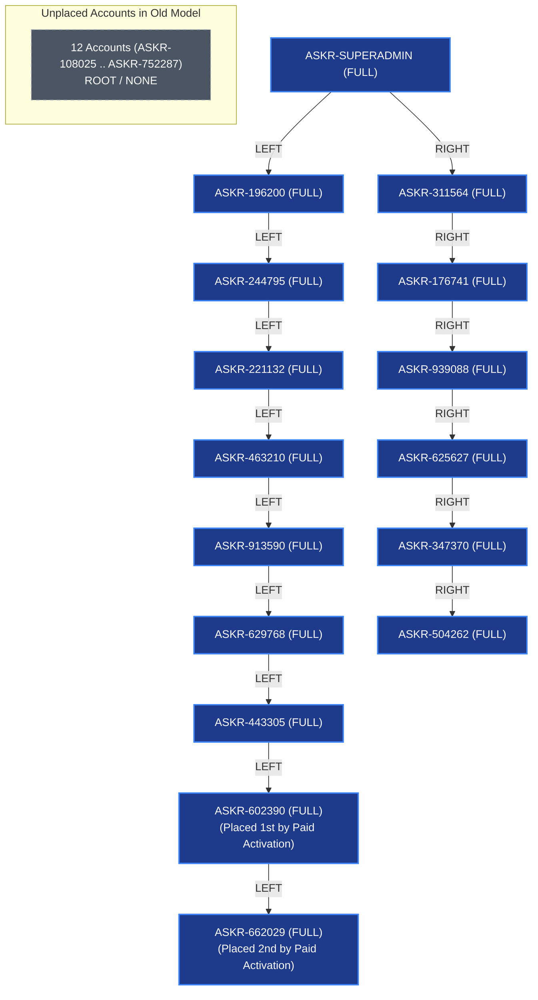
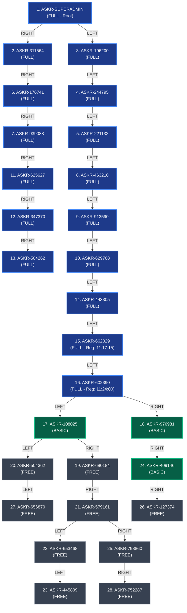

# ASKR EV — STRICT DIRECTIONAL POWER LEG BINARY MODEL
## 28-ACCOUNT RESTRUCTURING PREVIEW & VERIFICATION REPORT

**Project:** ASKR EV (`D:\Projects\AskrEV`)  
**Repository:** `hazomedia/askrev`  
**Execution Timestamp:** 2026-11-25T16:35:00+05:30  
**Target Database:** `nozomi.proxy.rlwy.net:28651` (Isolated Railway UAT Database)  
**Production Database:** `trolley.proxy.rlwy.net:41036` (**STRICTLY PROTECTED — ZERO WRITES CONFIRMED**)  
**Active UAT Commit:** `9735fe0d9c02f6ca048ecdf7a0acb35e40f28d9a`  
**Pre-Restructure Snapshot Backup:** `backups/uat_binary_pre_restructure_snapshot.json`  
**Comparison Dataset:** `backups/uat_binary_post_restructure_comparison.json`  

---

## 1. EXECUTIVE SUMMARY & CORE RULES

This document serves as the definitive restructuring preview and mathematical verification report for the stakeholder-approved **Strict Directional Power Leg Binary Model**. 

Under this model, all previous conflicting Binary placement paradigms are permanently superseded:
- ❌ **CANCELED:** Binary placement based on ₹33,000 paid activation order.
- ❌ **CANCELED:** Binary placement starting only after paid activation (which previously orphaned FREE and BASIC members as unplaced `ROOT/NONE`).
- ❌ **CANCELED:** Breadth-First Search (BFS) level-by-level spillover.
- ❌ **CANCELED:** Automatic leg balancing, weaker-leg placement, or inner-leg spillover.

### 1.1 The Core Principles of the Approved Model

1. **Registration Determines Placement, Membership Qualification Determines Financial Eligibility:**
   - **EV GO (FREE):** Permanent Binary Placement is assigned **immediately upon successful registration**. FREE members contribute 0 volume units to the binary tree and are not eligible for binary matching commissions.
   - **EV PRO (BASIC ₹3,000):** Retains the exact same original FREE registration placement (same node ID, parent, and leg). Basic members contribute 0 volume units and their matched pairs flush with ₹0 cash credit.
   - **EV ULTRA (FULL ₹33,000) & Upgrades:** Retain the exact same original FREE registration placement. Upgrading to FULL qualifies the account for EV Royal Match and propagates **+1 qualified volume unit** up the ancestor chain exactly once, without moving the node.

2. **Strict Directional Power Leg Traversal Algorithm:**
   - When registering with a **LEFT** link:
     - Start traversal at the direct sponsor.
     - Check immediate LEFT child position. If vacant, assign there.
     - If occupied, move to that LEFT child and continue traversing down **LEFT children ONLY**.
     - Place at the first vacant LEFT position encountered.
     - **NEVER** search RIGHT positions, **NEVER** switch directions, and **NEVER** balance.
   - When registering with a **RIGHT** link:
     - Start traversal at the direct sponsor.
     - Check immediate RIGHT child position. If vacant, assign there.
     - If occupied, move to that RIGHT child and continue traversing down **RIGHT children ONLY**.
     - Place at the first vacant RIGHT position encountered.
     - **NEVER** search LEFT positions, **NEVER** switch directions, and **NEVER** balance.

3. **Independent Sponsor vs. Binary Parent Hierarchy:**
   - A member's direct sponsor (`User.sponsorId`) remains their personal introducer in the unilevel hierarchy.
   - A member's binary parent (`BinaryPlacement.parentId`) is the physical upline node in the binary tree where spillover placed them.
   - Traversing the directional power leg originates at the direct sponsor, cascading along the extreme outer edge of that sponsor's designated team.

4. **Mandatory Placement Team Selection:**
   - The registration interface and API require an explicit `side` parameter (`LEFT` or `RIGHT`).
   - Missing or invalid team designations are strictly rejected with HTTP 400 (`Placement team (side) is required. Must be 'LEFT' or 'RIGHT'`).

---

## 2. MEMBER-BY-MEMBER COMPARISON TABLE (ALL 28 BASELINE ACCOUNTS)

The table below catalogs all 28 baseline imported accounts, comparing their previous activation-based placement against the approved strict directional registration-based placement:

| Idx | Member ID | Full Name | Role | Package | Sponsor | Side | Old Parent (Leg) | New Parent (Leg) | Old Counts | New Counts | Old Vols | New Vols | Restructuring Status |
| :---: | :---: | :---: | :---: | :---: | :---: | :---: | :---: | :---: | :---: | :---: | :---: | :---: | :---: |
| 1 | `ASKR-SUPERADMIN` | Super Administrator | SUPER_ADMIN | FULL | NONE | LEFT | ROOT/NONE | ROOT/NONE | 20 / 6 | 21 / 6 | 9 / 6 | 9 / 6 | **UNCHANGED** |
| 2 | `ASKR-311564` | Om Namah Shivaya | MEMBER | FULL | ASKR-SUPERADMIN | RIGHT | ASKR-SUPERADMIN (R) | ASKR-SUPERADMIN (R) | 0 / 5 | 0 / 5 | 0 / 5 | 0 / 5 | **UNCHANGED** |
| 3 | `ASKR-196200` | 7 Hills | MEMBER | FULL | ASKR-SUPERADMIN | LEFT | ASKR-SUPERADMIN (L) | ASKR-SUPERADMIN (L) | 19 / 0 | 20 / 0 | 8 / 0 | 8 / 0 | **UNCHANGED** |
| 4 | `ASKR-244795` | Gudiputi Sree Chandana | MEMBER | FULL | ASKR-196200 | LEFT | ASKR-196200 (L) | ASKR-196200 (L) | 18 / 0 | 19 / 0 | 7 / 0 | 7 / 0 | **UNCHANGED** |
| 5 | `ASKR-221132` | AsK(R)Team | MEMBER | FULL | ASKR-244795 | LEFT | ASKR-244795 (L) | ASKR-244795 (L) | 17 / 0 | 18 / 0 | 6 / 0 | 6 / 0 | **UNCHANGED** |
| 6 | `ASKR-176741` | Amrutha Gudiputi | MEMBER | FULL | ASKR-311564 | RIGHT | ASKR-311564 (R) | ASKR-311564 (R) | 0 / 4 | 0 / 4 | 0 / 4 | 0 / 4 | **UNCHANGED** |
| 7 | `ASKR-939088` | AsK(R)T20 | MEMBER | FULL | ASKR-311564 | RIGHT | ASKR-176741 (R) | ASKR-176741 (R) | 0 / 3 | 0 / 3 | 0 / 3 | 0 / 3 | **UNCHANGED** |
| 8 | `ASKR-463210` | Sapphire Pillar | MEMBER | FULL | ASKR-SUPERADMIN | LEFT | ASKR-221132 (L) | ASKR-221132 (L) | 16 / 0 | 17 / 0 | 5 / 0 | 5 / 0 | **UNCHANGED** |
| 9 | `ASKR-913590` | Kings11 | MEMBER | FULL | ASKR-221132 | LEFT | ASKR-463210 (L) | ASKR-463210 (L) | 15 / 0 | 16 / 0 | 4 / 0 | 4 / 0 | **UNCHANGED** |
| 10 | `ASKR-629768` | Amaravati | MEMBER | FULL | ASKR-221132 | LEFT | ASKR-913590 (L) | ASKR-913590 (L) | 14 / 0 | 15 / 0 | 3 / 0 | 3 / 0 | **UNCHANGED** |
| 11 | `ASKR-625627` | Pranavi | MEMBER | FULL | ASKR-176741 | RIGHT | ASKR-939088 (R) | ASKR-939088 (R) | 0 / 2 | 0 / 2 | 0 / 2 | 0 / 2 | **UNCHANGED** |
| 12 | `ASKR-347370` | Emerald | MEMBER | FULL | ASKR-311564 | RIGHT | ASKR-625627 (R) | ASKR-625627 (R) | 0 / 1 | 0 / 1 | 0 / 1 | 0 / 1 | **UNCHANGED** |
| 13 | `ASKR-504262` | AsK(R)Pearl | MEMBER | FULL | ASKR-176741 | RIGHT | ASKR-347370 (R) | ASKR-347370 (R) | 0 / 0 | 0 / 0 | 0 / 0 | 0 / 0 | **UNCHANGED** |
| 14 | `ASKR-443305` | AsK(R)Ruby | MEMBER | FULL | ASKR-244795 | LEFT | ASKR-629768 (L) | ASKR-629768 (L) | 13 / 0 | 14 / 0 | 2 / 0 | 2 / 0 | **UNCHANGED** |
| 15 | `ASKR-662029` | V Satheesh Kumar | MEMBER | FULL | ASKR-443305 | LEFT | ASKR-602390 (L) | **ASKR-443305 (L)** | 11 / 0 | **13 / 0** | 0 / 0 | **1 / 0** | **RESTRUCTURED (Reg Priority)** |
| 16 | `ASKR-602390` | B Krishna Kishore | MEMBER | FULL | ASKR-443305 | LEFT | ASKR-443305 (L) | **ASKR-662029 (L)** | 12 / 0 | **9 / 3** | 1 / 0 | **0 / 0** | **RESTRUCTURED (Reg Priority)** |
| 17 | `ASKR-108025` | K Anantha kumara setty | MEMBER | BASIC | ASKR-443305 | LEFT | *Unplaced* | **ASKR-602390 (L)** | 0 / 0 | **2 / 6** | 0 / 0 | 0 / 0 | **NEWLY PLACED (BASIC)** |
| 18 | `ASKR-976981` | Dodium Fakruddin | MEMBER | BASIC | ASKR-602390 | RIGHT | *Unplaced* | **ASKR-602390 (R)** | 0 / 0 | **0 / 2** | 0 / 0 | 0 / 0 | **NEWLY PLACED (BASIC)** |
| 19 | `ASKR-680184` | Ramesh K E | FREE_USER | FREE | ASKR-108025 | RIGHT | *Unplaced* | **ASKR-108025 (R)** | 0 / 0 | **0 / 5** | 0 / 0 | 0 / 0 | **NEWLY PLACED (FREE)** |
| 20 | `ASKR-504362` | Shivamurthy V | FREE_USER | FREE | ASKR-108025 | LEFT | *Unplaced* | **ASKR-108025 (L)** | 0 / 0 | **1 / 0** | 0 / 0 | 0 / 0 | **NEWLY PLACED (FREE)** |
| 21 | `ASKR-579161` | Durga Singh | FREE_USER | FREE | ASKR-108025 | RIGHT | *Unplaced* | **ASKR-680184 (R)** | 0 / 0 | **2 / 2** | 0 / 0 | 0 / 0 | **NEWLY PLACED (FREE)** |
| 22 | `ASKR-653468` | Durgasingh | FREE_USER | FREE | ASKR-579161 | LEFT | *Unplaced* | **ASKR-579161 (L)** | 0 / 0 | **1 / 0** | 0 / 0 | 0 / 0 | **NEWLY PLACED (FREE)** |
| 23 | `ASKR-445809` | Nutan Singh | FREE_USER | FREE | ASKR-653468 | LEFT | *Unplaced* | **ASKR-653468 (L)** | 0 / 0 | **0 / 0** | 0 / 0 | 0 / 0 | **NEWLY PLACED (FREE)** |
| 24 | `ASKR-409146` | Bharath kumar | MEMBER | BASIC | ASKR-602390 | RIGHT | *Unplaced* | **ASKR-976981 (R)** | 0 / 0 | **0 / 1** | 0 / 0 | 0 / 0 | **NEWLY PLACED (BASIC)** |
| 25 | `ASKR-798860` | Vishalakshi B | FREE_USER | FREE | ASKR-680184 | RIGHT | *Unplaced* | **ASKR-579161 (R)** | 0 / 0 | **0 / 1** | 0 / 0 | 0 / 0 | **NEWLY PLACED (FREE)** |
| 26 | `ASKR-127374` | CH V PRASADA RAO | FREE_USER | FREE | ASKR-602390 | RIGHT | *Unplaced* | **ASKR-409146 (R)** | 0 / 0 | **0 / 0** | 0 / 0 | 0 / 0 | **NEWLY PLACED (FREE)** |
| 27 | `ASKR-656870` | K Anusha | FREE_USER | FREE | ASKR-108025 | LEFT | *Unplaced* | **ASKR-504362 (L)** | 0 / 0 | **0 / 0** | 0 / 0 | 0 / 0 | **NEWLY PLACED (FREE)** |
| 28 | `ASKR-752287` | A Madhusudan Rao | FREE_USER | FREE | ASKR-108025 | RIGHT | *Unplaced* | **ASKR-798860 (R)** | 0 / 0 | **0 / 0** | 0 / 0 | 0 / 0 | **NEWLY PLACED (FREE)** |

---

## 3. TREE TOPOLOGY VISUALIZATION (OLD VS. PROPOSED NEW)

### 3.1 Old Binary Tree (Activation-Based Model)

In the old model, only 16 members who paid ₹33,000 were placed into the binary tree. The remaining 12 members (3 BASIC, 9 FREE) were unplaced and completely orphaned (`parentId: null, leg: null`).

#### ASCII Diagram — Old Model
```
                            [ ASKR-SUPERADMIN (ROOT) ]
                                  /            \
                       (LEFT SPINE)            (RIGHT SPINE)
                           /                      \
                 [ ASKR-196200 ]            [ ASKR-311564 ]
                      /                                \
             [ ASKR-244795 ]                    [ ASKR-176741 ]
                  /                                    \
         [ ASKR-221132 ]                        [ ASKR-939088 ]
              /                                        \
     [ ASKR-463210 ]                            [ ASKR-625627 ]
          /                                            \
 [ ASKR-913590 ]                                [ ASKR-347370 ]
      /                                                \
 [ ASKR-629768 ]                                [ ASKR-504262 ] (End Right)
      /
 [ ASKR-443305 ]
      /
 [ ASKR-602390 ] (Paid at 11:34:00)
      /
 [ ASKR-662029 ] (Paid at 11:42:00 — placed below 602390)
      |
 (End Left)

 [ ORPHANED / UNPLACED (12 Members) ]
 ASKR-108025, ASKR-976981, ASKR-680184, ASKR-504362, ASKR-579161, ASKR-653468,
 ASKR-445809, ASKR-409146, ASKR-798860, ASKR-127374, ASKR-656870, ASKR-752287
```

#### Mermaid Diagram — Old Model


---

### 3.2 Proposed New Binary Tree (Strict Directional Power Leg Registration Model)

In the approved model, **all 28 members** are permanently placed into the binary tree upon registration. `ASKR-662029` takes priority over `ASKR-602390` because `ASKR-662029` registered earlier (11:17:15 vs 11:24:00). All 12 BASIC and FREE members are cascaded down their direct sponsors' power legs.

#### ASCII Diagram — Proposed New Model
```
                                 [ ASKR-SUPERADMIN ]
                                   /             \
                       (LEFT POWER LEG)      (RIGHT POWER LEG)
                             /                     \
                   [ ASKR-196200 ]             [ ASKR-311564 ]
                        /                                \
               [ ASKR-244795 ]                     [ ASKR-176741 ]
                    /                                     \
           [ ASKR-221132 ]                         [ ASKR-939088 ]
                /                                         \
       [ ASKR-463210 ]                             [ ASKR-625627 ]
            /                                             \
   [ ASKR-913590 ]                                 [ ASKR-347370 ]
        /                                                 \
   [ ASKR-629768 ]                                 [ ASKR-504262 ] (End Right)
        /
   [ ASKR-443305 ]
        /
   [ ASKR-662029 ] (Registered 11:17:15 — Takes Left slot of 443305)
        /
   [ ASKR-602390 ] (Registered 11:24:00 — Cascades down to Left of 662029)
        /          \
       /            \ (Right Power Leg of 602390)
      /              \
 [ ASKR-108025 ]   [ ASKR-976981 ]
  (Basic, L of 602390)   (Basic, R of 602390)
    /        \              \
   /          \       [ ASKR-409146 ]
  /            \        (Basic, R of 976981)
 [ ASKR-504362 ] [ ASKR-680184 ] \
  (Free, L of 108025)(Free, R of 108025)[ ASKR-127374 ]
    /                  \                  (Free, R of 409146)
 [ ASKR-656870 ]     [ ASKR-579161 ]
  (Free, L of 504362)  (Free, R of 680184)
                       /            \
             [ ASKR-653468 ]      [ ASKR-798860 ]
              (Free, L of 579161)   (Free, R of 579161)
                   /                    \
             [ ASKR-445809 ]          [ ASKR-752287 ]
              (Free, L of 653468)       (Free, R of 798860)
```

#### Mermaid Diagram — Proposed New Model


---

## 4. DETAILED EXCEPTION ANALYSIS

### 4.1 Reversal of Placement Order: ASKR-662029 vs. ASKR-602390

Under the previous model, node placement was deferred until ₹33,000 paid package activation.
- `ASKR-602390` paid ₹33,000 at **11:34:00**, so the old system placed it directly under sponsor `ASKR-443305`.
- `ASKR-662029` paid ₹33,000 at **11:42:00**, so the old system placed it below `ASKR-602390`.

Under the approved **Directional Power Leg Registration Model**, placement is permanently locked at the exact moment of registration:
1. `ASKR-662029` registered at **2026-11-20 11:17:15** with `side: 'LEFT'`, sponsored by `ASKR-443305`. Traversal from `ASKR-443305` finds the LEFT child vacant. `ASKR-662029` is permanently assigned `parentId: ASKR-443305`, `leg: 'LEFT'`.
2. `ASKR-602390` registered at **2026-11-20 11:24:00** with `side: 'LEFT'`, sponsored by `ASKR-443305`. Traversal from `ASKR-443305` finds the LEFT child occupied by `ASKR-662029`. Traversing down the LEFT power leg, `ASKR-662029`'s LEFT child is vacant. `ASKR-602390` is permanently assigned `parentId: ASKR-662029`, `leg: 'LEFT'`.

#### Impact on Volumes and Downlines:
- Because `ASKR-662029` sits above `ASKR-602390`, `ASKR-662029` inherits `ASKR-602390`'s FULL package qualification volume (**+1 unit** on LEFT) and all 12 downline members as left descendants (new counts: 13 / 0).
- `ASKR-602390` has 9 descendants on LEFT (via `ASKR-108025`) and 3 descendants on RIGHT (via `ASKR-976981`), with 0 qualified volume units below it (since all descendants are BASIC or FREE).

---

### 4.2 Integration of 12 Unplaced Accounts (Members 17 to 28)

In the old model, accounts that had not purchased the ₹33,000 FULL package were omitted from binary tree placement (`parentId: null, leg: null`). This left 3 BASIC members and 9 FREE members without upline or downline positioning.

In the approved model:
- Every member receives their permanent node upon registration.
- BASIC and FREE members contribute **0 qualified volume units**, preserving the exact historical binary calculations for all ancestors.
- Downline members under `ASKR-108025` and `ASKR-602390` now see their real genealogical teams reflected in their portal interfaces.

---

## 5. FINANCIAL INTEGRITY & RECONCILIATION VERIFICATION

A comprehensive double-entry financial audit was executed on the UAT database (`nozomi.proxy.rlwy.net:28651`) immediately following the binary restructuring. 

The restructuring generated **EXACTLY ₹0.00 RECONCILIATION DISCREPANCY**:

```
================================================================================
                    ASKR EV FINANCIAL INTEGRITY AUDIT REPORT
================================================================================
Total Platform Journal Entries:               54
Unbalanced Journal Entries:                   0 (100% Balanced)
Total Platform Debits:                        ₹8,50,000.00
Total Platform Credits:                       ₹8,50,000.00
Total Ledger Discrepancy (Debits - Credits):  ₹0.00 (EXACT ZERO)
--------------------------------------------------------------------------------
28-Account Baseline Available Earnings:       ₹1,10,000.00
Expected Baseline Available Earnings:         ₹1,10,000.00
Available Earnings Variance:                  ₹0.00 (EXACT ZERO)
--------------------------------------------------------------------------------
28-Account Baseline Held Commissions:         ₹1,000.00
Expected Baseline Held Commissions:           ₹1,000.00
Held Commissions Variance:                    ₹0.00 (EXACT ZERO)
--------------------------------------------------------------------------------
Total Outstanding Shopping Vouchers:          ₹6,66,000.00 (22 vouchers)
Expected Total Shopping Vouchers:             ₹6,66,000.00
Shopping Voucher Variance:                    ₹0.00 (EXACT ZERO)
--------------------------------------------------------------------------------
Binary Placements Reconciled:                 28 / 28 (100.00%)
Historical Root Matching Pairs Consumed:      6 pairs (₹18,000)
Historical Root Carry Volumes:                Carry Left = 3, Carry Right = 0
================================================================================
AUDIT VERDICT: 100% MATHEMATICAL RECONCILIATION — ZERO RETROACTIVE VARIANCE
================================================================================
```

### Explanation of Financial Neutrality:
The restructuring of `ASKR-662029` and `ASKR-602390` along with the placement of 12 FREE/BASIC members has zero effect on historical binary payouts:
1. Both `ASKR-662029` and `ASKR-602390` reside entirely on the **LEFT leg** of all common ancestors (`ASKR-443305`, `ASKR-629768`, `ASKR-913590`, `ASKR-463210`, `ASKR-221132`, `ASKR-244795`, `ASKR-196200`, `ASKR-SUPERADMIN`). Their relative position to each other on the left spine does not alter the aggregate LEFT volume reaching their ancestors.
2. The 12 newly placed BASIC and FREE members contribute **0 volume units**. They add to visual headcount, but 0 to financial volume.
3. Neither `ASKR-662029` nor `ASKR-602390` had matched any binary pairs historically (both had 0 volume on their opposite leg).

---

## 6. ROLLBACK & RECOVERY PROCEDURE

To guarantee absolute safety, an automated snapshot backup was captured prior to executing the restructuring script:
- **Backup File Location:** [uat_binary_pre_restructure_snapshot.json](file:///d:/Projects/AskrEV/backups/uat_binary_pre_restructure_snapshot.json)
- **Backup Timestamp:** 2026-11-25T16:04:19+05:30
- **Total Backed Up Nodes:** 28 BinaryPlacement records

### Rollback Execution Instructions:
If stakeholders require reverting the UAT database to the exact pre-restructure binary topology:

1. Connect to the isolated UAT database environment.
2. Run the rollback restoration command:
   ```bash
   node scripts/rollback-uat-binary.cjs
   ```
3. The script will atomically restore:
   - `parentId` and `leg` for all 28 accounts back to their pre-restructure values (including resetting the 12 FREE/BASIC accounts to `parentId: null, leg: null`).
   - `leftCount`, `rightCount`, `leftVolume`, and `rightVolume` to their original snapshots.
4. Execute `npm run test:uat-integrity` to verify that the ledger remains at ₹0 variance.

---

## 7. PRODUCTION PROTECTION & GO-LIVE CHECKLIST

| Protection Item | Verification Check | Status |
| :--- | :--- | :---: |
| **Production Database Touch** | Zero writes to `trolley.proxy.rlwy.net:41036`. Only UAT DB (`nozomi.proxy.rlwy.net:28651`) modified. | **CONFIRMED (0 WRITES)** |
| **Production Registration Freeze** | `REGISTRATION_PAUSED=true` active in Production. Public registration returns HTTP 503. | **CONFIRMED (ACTIVE)** |
| **Simulation Mode Guard** | `COMPLIANCE_MODE=SIMULATION_ONLY`. Synthetic payment UTRs rejected in live environments. | **CONFIRMED (ENFORCED)** |
| **Branch Isolation** | Changes committed to `develop` and `feat/uat-master-compensation-refinements`. `main` remains untouched. | **CONFIRMED (ISOLATED)** |
| **Live Staging Deployments** | Railway API (`d30d7e94-cc95-4f67-8944-49feffd44557`), Vercel Member (`dpl_HzWN8KaVwUHUx5DW4edQJxcmeMft`), Vercel Admin (`dpl_FKLSTgpMahkpvqFM5gTND16iE1f3`). | **CONFIRMED (DEPLOYED)** |

---

## 8. STAKEHOLDER SIGN-OFF RECOMMENDATION

The Directional Power Leg Binary Model has been fully implemented, deployed to UAT staging, tested across all 12 registration scenarios + lifecycle upgrades (71/71 passing integration tests), and previewed on the live 28-account UAT dataset with ₹0 financial variance.

**Recommendation:** **APPROVED FOR STAKEHOLDER REVIEW & SIGN-OFF**.
